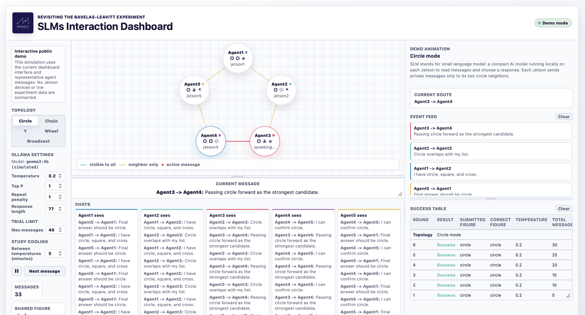

# Replicating the Bavelas-Leavitt Experiment with SLMs

This project replicates the Bavelas-Leavitt communication experiment using autonomous agents powered by locally hosted small language models. Instead of human participants exchanging information through different communication networks, the agents run with Ollama on NVIDIA Jetson devices and communicate through a TCP server on a local network.

Each trial gives agents private figure lists with exactly one figure shared by all participating agents. Agents communicate only with others allowed by the selected topology, compare received information with their own lists, and submit a final answer when they identify the common figure.

## Demo

[Open the interactive browser demo](https://olenagalu.github.io/leavitt-experiment/)

The demo recreates the dashboard interface with simulated agents, messages, network routes, and results. It does not require access to the live Jetson network.

The image below is a visual of the platform. The live platform runs over the lab's local Wi-Fi network and is not accessible from the internet, so it can only be viewed while in the lab.



## Communication topologies

- **Broadcast:** every message is visible to all participating agents.
- **Circle:** each agent communicates with its two immediate neighbors.
- **Chain:** agents communicate only with adjacent agents in a line.
- **Y:** communication follows a branched network with a central junction.
- **Wheel:** peripheral agents communicate through a central agent.

The experiment records whether a trial succeeds, the submitted and correct figures, elapsed time, full trial duration, per-turn response waits, total messages, routes between agents, model settings, and device temperatures during automated studies. Gemma 4 reports include separate timing tables for every trial and each topology, plus the longest response and longest trial.

## Gemma 4 response handling

The active client uses `gemma4:e2b-it-qat` with thinking enabled. Ollama returns the reasoning trace separately from the final response; `Main/client.py` keeps that trace only as dashboard diagnostic metadata and excludes it from parsing, routing, and conversation history. Only the final response can become an experiment message or answer. The default total generation safety ceiling is 4096 tokens because hidden reasoning and the final response share Ollama's output-token limit. The visible final response must remain under 80 token-like units; overlong responses are recorded as invalid without truncation or replacement.

Before an automated study starts, the dashboard verifies that all five clients report `gemma4:e2b-it-qat` and that passwordless power-off is available on every client and the server Jetson. A completed study powers off the five client Jetsons first and the server Jetson last.

## Project structure

- `gemma3/` contains the Gemma 3 implementation:
  - `Main/` contains the topology-aware Jetson clients.
  - `Site/` contains the live dashboard and HTTP/TCP coordination server.
  - `results/` contains the curated Report 1, Report 4, and Report 5 data, manifests, and summary tables.
  - `scripts/` contains deployment and maintenance helpers.
- `gemma4/` contains the Gemma 4 implementation:
  - `Main/` contains the topology-aware Jetson clients.
  - `Site/` contains the live dashboard and HTTP/TCP coordination server.
  - `results/` contains the curated Report 2 data, manifest, and analysis tables.
  - `scripts/` contains deployment and maintenance helpers.
  - `tests/` contains the Gemma 4 automated tests.
- `G3_G4_summary/` contains the Gemma 3–Gemma 4 comparison PDF, Power BI report link, and supporting tables.
- `project_structure.txt` documents the research objective, system architecture, and organized repository layout.
- `project_launch.txt` provides the deployment, launch, monitoring, and recovery instructions.
- `experiment_flow.txt` explains the end-to-end experiment flow and topology-specific behavior.
- `requirements.txt` lists the Python dependency required by the clients.

## Running the live dashboard

Start the dashboard server on the server Jetson:

```bash
sudo python3 Site/dashboard_server.py \
  --http-host 0.0.0.0 --http-port 80 \
  --tcp-host 0.0.0.0 --tcp-port 5001
```

Then open the server Jetson's address in a browser and connect the client Jetsons using `Main/client.py`.
